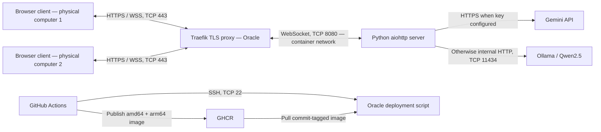

# Relay

A browser chat application for **2110471 Computer Network I**, built with an asynchronous Python WebSocket backend (`aiohttp` + `Pydantic v2` Dispatcher) and a separate HTML/CSS/JavaScript browser client. All messaging and chat actions travel exclusively through native **WebSockets** over a single `/ws` endpoint. No polling or HTTP chat endpoints.

**Live app:** <https://relay.161.118.238.148.sslip.io>  
**Repository:** <https://github.com/Quackudy/2110471-Computer-Network-I-Websocket-Project>

---

## Architecture Highlights

* **Single Persistent WebSocket Endpoint (`/ws`):** All chat interactions—registration, presence, private chat, group creation, self-joining, text messaging, Base64 file transfers, read receipts, and AI summarization—are processed over a single WebSocket connection.
* **Pydantic Validation Layer:** Incoming JSON commands are strongly validated using Pydantic models (`RegisterCmd`, `OpenPrivateCmd`, `CreateGroupCmd`, `JoinGroupCmd`, `MessageCmd`, `FileCmd`, `ReceiptCmd`, `SummarizeCmd`).
* **Clean Dispatcher Pattern:** A central `dispatch()` method routes commands to focused handler functions, catching validation errors centrally and returning clean error frames to the client.
* **Lightweight In-Memory State:** Rooms and messages live in memory with automatic ring-buffering (`collections.deque(maxlen=100)`), avoiding database locking and maintaining high performance.

> 📖 **Deep-Dive Architecture & Lifecycle Guide:** For an end-to-end walkthrough covering the WebSocket handshake, room routing, 3-stage receipt progression, Base64 file transfer, AI locking, and disconnect cleanup with sequence diagrams, see [docs/how_it_works.md](docs/how_it_works.md).

---

## Run Locally

Requires Python 3.11 or newer (the container and deployment use 3.13).

```bash
python -m venv .venv

# On Linux/macOS:
source .venv/bin/activate
# On Windows PowerShell:
.venv\Scripts\Activate.ps1

pip install -r requirements.txt
python server.py
```

Open <http://localhost:8080> and choose a name. To demonstrate R1 locally, open `http://SERVER_LAN_IP:8080` on **two different physical computers** on the same local network. The cloud deployment allows both computers to use the live HTTPS URL instead.

Configuration defaults can be customized via `.env` (refer to `.env.example`).

---

## AI Catch-Up Summaries

The server uses **Gemini 3.8 Flash** for summaries when `GEMINI_API_KEY` is configured. Google currently lists this model on its [free tier](https://ai.google.dev/gemini-api/docs/pricing), subject to usage limits. Create a key in [Google AI Studio](https://aistudio.google.com/app/apikey), then add it as the repository's GitHub Actions secret `GEMINI_API_KEY` for Oracle deployment. Keep the key out of the browser and repository. Summarized chat text is sent to Google when this option is enabled. Without a key, the existing local **Ollama / Qwen2.5 0.5B** summary remains available.

To run the full stack (server + Ollama) locally with Docker:

```bash
docker compose up --build -d --wait --wait-timeout 600
```

Open <http://localhost:8080>. The first startup pulls the Ollama container and downloads the model weights (~398 MB) into a persistent Docker volume.

---

## Assignment Coverage (12.5 / 12.5 Points)

| Requirement | Description & Implementation | Reference Code |
|---|---|---|
| **R1** | Two physical browser clients $\to$ Oracle HTTPS/WSS proxy $\to$ Python server | `compose.oracle.yml`, architecture diagram below |
| **R2** | `/ws` is the only chat transport; server and client are separate files | `server.py:ws_handler`, `static/app.js:connect` |
| **R3** | Unique, case-insensitive names reserved for the active connection | `RegisterCmd`, `handle_register` |
| **R4** | Online list includes everyone, including the current user | `broadcast_presence`, `static/app.js:renderNav` |
| **R5** | Dedicated chat room for each 1-on-1 private pair and each group | `OpenPrivateCmd`, `handle_open_private`, `handle_create_group` |
| **R6** | Separate room histories, message log window, and text input box | `renderMessages`, `#composer` |
| **R7** | Private delivery only to the two participants; sender derived on server | `authorized_room`, `handle_message` |
| **R8** | New group contains only its creator initially | `CreateGroupCmd`, `handle_create_group` |
| **R9** | Everyone receives all group names and current member lists in real time | `broadcast_presence`, `describe_room` |
| **R10** | Users explicitly join groups by themselves; no forced additions | `JoinGroupCmd`, `handle_join_group` |
| **R11** | Group messages accepted from and delivered to room members only | `authorized_room`, `handle_message` |

### Part 3 Special Points (4 Points)
1. **AI Chat Summarization (1.0 pt):** Gemini 3.8 Flash with an API key, or local Qwen2.5 0.5B via Ollama (`SummarizeCmd`, `execute_summarize`).
2. **Socket File Sharing (1.0 pt):** Base64 file transfer (up to 256 KiB) strictly through WebSocket frames (`FileCmd`, `handle_file`).
3. **Delivery & Read Receipts (1.0 pt):** Real-time status tracking (Sent $\to$ Delivered $\to$ Read) broadcast to participants (`ReceiptCmd`, `handle_receipt`).
4. **Cloud Deployment (1.0 pt):** Live Oracle Cloud instance with Docker, Traefik TLS proxy, and automated GitHub Actions CI/CD. *(Explicitly noted in the rubric: "Cloud-based deployment is allowed but optional and will be marked as one special point")*.

---

## System Architecture



**Protocol explanation:**
* **IP / TCP:** Route packets between hosts and provide reliable, ordered byte streams.
* **HTTPS:** Serves the browser client interface and performs the HTTP-to-WebSocket upgrade handshake (`Upgrade: websocket`).
* **WebSocket / WSS:** Persistent, bidirectional message framing. Every chat command, receipt, and file travels exclusively over `/ws`.
* **JSON:** Application-layer event format inside WebSocket frames.
* **TLS:** Encrypts public traffic between browsers and the Traefik proxy.
* **SSH:** Authenticates deployment connections from GitHub Actions to Oracle Cloud.
* **AI request:** When configured, the Python server calls Gemini over HTTPS; otherwise it calls Ollama over the private Docker network.

---

## Auto-Deployment Pipeline

Each code push to **main** triggers the GitHub Actions workflow (`.github/workflows/deploy.yml`):
1. **Publish:** Builds a multi-architecture container image (`linux/amd64` and `linux/arm64`) and pushes it to GitHub Container Registry (GHCR).
2. **Deploy:** Connects to the Oracle Cloud instance over SSH, transfers `compose.yml` and `compose.oracle.yml`, pulls the latest commit-tagged image, restarts the container, and verifies the public `/healthz` endpoint over HTTPS.

---

## Documentation & Presentation

* **System Execution & Protocol Walkthrough:** [docs/how_it_works.md](docs/how_it_works.md) details every lifecycle from connection handshake to 3-stage receipt progression and AI locking with sequence diagrams.
* **20-Slide Implementation Presentation:** Fully documented in [docs/slide_preparation.md](docs/slide_preparation.md). It matches the instructor's slide template page-by-page, providing:
  * Engineering-grade **Generative AI Prompts** used for each requirement.
  * Concise **Code Snapshots** designed to fit presentation slide code blocks.
  * **Speaker Notes & Talking Points** for the live demonstration.

### Live Demo Checklist
1. **R1:** Open `https://relay.161.118.238.148.sslip.io` on **two different physical laptops**.
2. **R3:** Register "Alice" on Laptop 1; attempt to register "alice" on Laptop 2 $\to$ verify duplicate rejection.
3. **R7:** Connect a 3rd client ("Eve"). Send a private message between Alice and Bob $\to$ verify Eve receives nothing.
4. **R8–R10:** Create a group on Alice's client (Alice starts alone). Show the group in Bob's sidebar. Bob clicks "Join" to self-join.
5. **R11:** Send a group message $\to$ verify Eve does not receive it.
6. **Special Features:**
   * Transfer a file (`notes.txt` or an image) via WebSocket.
   * Observe Sent $\to$ Delivered $\to$ Read receipt status markers.
   * Click **Summarize** in an active conversation to demonstrate Gemini when configured, or the local Qwen2.5 fallback.
   * Point out the live HTTPS URL, Traefik TLS certificate, and the automated GitHub Actions pipeline.

---

## Limits & Boundaries

* **In-Memory Storage:** Messages (up to 100 per room via `deque(maxlen=100)`), active rooms, and sessions live in RAM. Restarting the server clears active sessions.
* **Rate Limiting:** Sliding-window rate limit (max 20 requests per second per connection) prevents flooding.
* **Payload Limits:** Text messages up to 4,000 characters; files up to 256 KiB; names between 1 and 24 characters.
