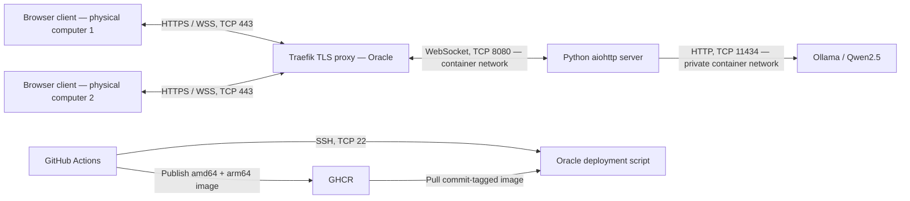

# Relay

A browser chat application for **2110471 Computer Network I**, built with a Python socket server and a separate HTML/CSS/JavaScript browser client. Private messages and group messages travel exclusively through native **WebSockets**. No polling or HTTP chat endpoints.

**Live app:** <https://relay.161.118.238.148.sslip.io>  
**Repository:** <https://github.com/Quackudy/2110471-Computer-Network-I-Websocket-Project>

## Run locally

Requires Python 3.11 or newer (the container and CI use 3.13).

```bash
python3 -m venv .venv
source .venv/bin/activate
pip install -r requirements.txt
python server.py
```

Open <http://localhost:8080> and choose a name. To demonstrate R1 locally, open `http://SERVER_LAN_IP:8080` on **two different physical computers** on the same network and allow TCP 8080 through the server firewall. The cloud deployment allows both computers to use the live HTTPS URL instead. Multiple tabs alone do not satisfy R1.

For Windows, activate with `.venv\Scripts\Activate.ps1`.

## AI summaries

The server calls **Qwen2.5 0.5B Instruct**, a real language model served by **Ollama**. The deployment downloads its weights once into a persistent Docker volume. There is no paid API and room messages are processed on the Oracle server, not sent to a third-party inference service. [Model reference](https://ollama.com/library/qwen2.5:0.5b), [upstream model card](https://huggingface.co/Qwen/Qwen2.5-0.5B-Instruct), [Ollama API](https://docs.ollama.com/api/chat).

For a Python-only local run, install Ollama separately, run `ollama pull qwen2.5:0.5b`, and leave its server running on localhost:11434. Chat still works if AI is unavailable; the Summarize button reports the error.

Alternatively, run the full stack:

```bash
docker compose up --build -d --wait --wait-timeout 600
```

Open <http://localhost:8080>. First startup downloads the Ollama image and roughly 398 MB of model weights. CPU generation can take several seconds. Ollama has no host-published port.

## Assignment coverage

| Requirement | Implementation | Code to explain |
|---|---|---|
| R1 | Two physical browser clients → Oracle HTTPS proxy → Python server | `compose.oracle.yml`, architecture below |
| R2 | `/ws` is the only chat transport; server and client are separate files | `server.py:Chat.websocket`, `static/app.js:connect` |
| R3 | Unique, case-insensitive names reserved for the active connection | `Chat.command` registration |
| R4 | Online list includes everyone, including the current user | `Chat.presence`, `renderNav` |
| R5 | One private room per participant pair; independent group rooms | `open_private`, `create_group`, `state.rooms` |
| R6 | Separate room histories, message log, and text input | `renderMessages`, `#composer` |
| R7 | Private delivery only to the two participants; sender identity is server-derived | `authorized_room`, `broadcast` |
| R8 | New group contains its creator only | `create_group` |
| R9 | Everyone receives all group names and current member lists | `presence`, `renderNav` |
| R10 | Users explicitly join themselves; no add-other-member command exists | `join_group` |
| R11 | Group messages accepted from and delivered to members only | `authorized_room`, `broadcast` |

Bonus candidates: **AI summaries**, **socket file sharing**, **delivery/read receipts**, and **cloud deployment**. Search is also included. Cloud deployment is explicitly recognized by the rubric; other bonus choices still depend on the instructor's assessment.



**Protocol explanation:** IP routes packets between hosts. TCP provides reliable, ordered transport. HTTP(S) serves the interface and performs the WebSocket upgrade handshake. WebSocket provides persistent, bidirectional message frames, so TCP partial reads/framing are handled by the WebSocket implementation. JSON describes application commands inside those frames. TLS encrypts the public browser connection; SSH authenticates the deployment connection. The internal HTTP AI call performs model inference, not client-to-client chat delivery.

## Tests

```bash
python -m unittest discover -s tests -v
pip install -r requirements-dev.txt
python -m playwright install chromium
# With python server.py running in another terminal:
python scripts/browser_smoke.py
# Full cloud test, including a real AI summary:
python scripts/browser_smoke.py https://relay.161.118.238.148.sslip.io --ai
```

The socket tests cover unique names, presence/disconnects, sender spoofing, private/group access boundaries, explicit joining, no pre-join history disclosure, files and limits, origin rejection, malformed input, receipts, bounded history, and AI authorization/error handling. The browser test uses three independent sessions and checks actual sending, file downloads, literal HTML escaping, search, receipts, mobile layout, and disconnects. Screenshots go to ignored `test-results/`.

## Auto-deployment

Each push to **main** runs tests, publishes a multi-architecture image to **GHCR**, and deploys the exact commit tag to Oracle. Pull requests run tests without deployment. Actions are pinned to commit hashes. Registry access uses the short-lived `GITHUB_TOKEN`, passed over SSH on stdin. Registry credentials are removed after each deployment. Failed container health checks restore the previous application image when one exists.

GitHub Actions secrets:

| Secret | Purpose |
|---|---|
| `ORACLE_HOST` | Oracle address |
| `ORACLE_USER` | SSH user with Docker permission |
| `ORACLE_SSH_KEY` | Dedicated deployment key |
| `ORACLE_KNOWN_HOSTS` | Pinned Oracle SSH host key |

The Oracle deployment files are in `~/relay`. The app joins the existing `eventory-production_default` network so the installed Traefik proxy can discover its unique `relay` router. It uses `relay.161.118.238.148.sslip.io` and the proxy's existing `letsencrypt` certificate resolver. This hostname uses sslip.io's IP-based DNS; an owned domain can replace it via `APP_DOMAIN` and the workflow's public-health URL.

To inspect the deployed stack:

```bash
cd ~/relay
APP_IMAGE=$(cat .image) docker compose -f compose.yml -f compose.oracle.yml ps
APP_IMAGE=$(cat .image) docker compose -f compose.yml -f compose.oracle.yml logs --tail=100 app
```

Never commit SSH keys, GitHub tokens or `.env` files. The image uses a file allowlist and never includes deployment credentials. The supplied personal GitHub token is used only locally to configure repository secrets and push code; it is not installed on Oracle or stored in Actions.

## Presentation and live demo

Open `docs/implementation.html` locally. It follows the supplied **20-slide implementation explanation** template, contains real code excerpts, and includes a prompt disclosure. Use arrow keys to move slides or print to PDF. Regenerate after code changes with `python scripts/build_slides.py`.

Before submission, replace the title-slide group/member placeholders. Demo with at least two physical computers and preferably three connected clients:

1. Connect Alice and Bob on different computers. Explain the architecture and protocol stack.
2. Connect a third client. Try a duplicate name; show all clients in the online list.
3. Send private messages and a file. Show that the third client receives neither.
4. Create a group. Show that only the creator is initially a member and everyone can browse its member list.
5. Have Bob explicitly join, then exchange group messages. Show that the third client remains outside.
6. Show distinct room histories, message search, delivery/read receipts, and an actual AI summary.
7. Disconnect a client and show the updated lists. Show the successful GitHub workflow and running ARM64 containers.

## Intentional limits

This is a course demonstration with session-based names, not permanent accounts. Anyone with the public URL can join under an unused name. HTTPS protects transport; it is not end-to-end encryption and the server can read messages. Room access checks protect the current connected participants.

History is in memory: **100 messages per room**, **100 rooms**, **100 connected users**, a **32 MiB server history budget**, text up to **4,000 characters**, and files up to **256 KiB**. Restarting or redeploying clears users, rooms, and chat history. A disconnected user receives a new identity when reconnecting and must rejoin groups; former private rooms do not attach to a reused name. New group members do not receive pre-join history. AI summarizes only the requesting user's authorized text history (up to the latest 30 messages / 12,000 characters), returns it only to that user, and can make mistakes.
