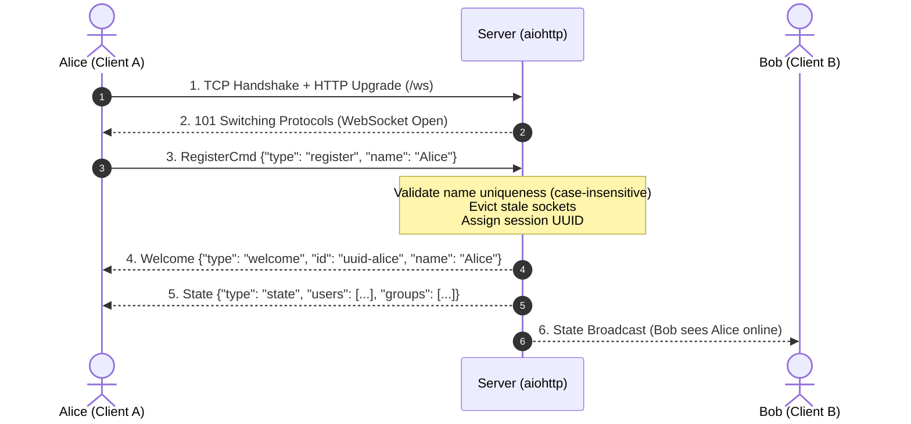
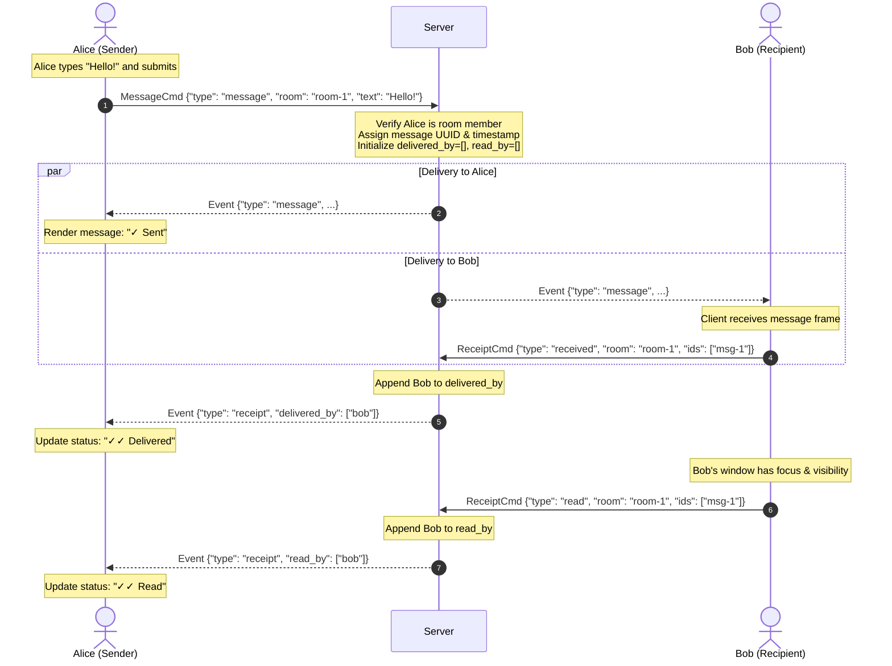
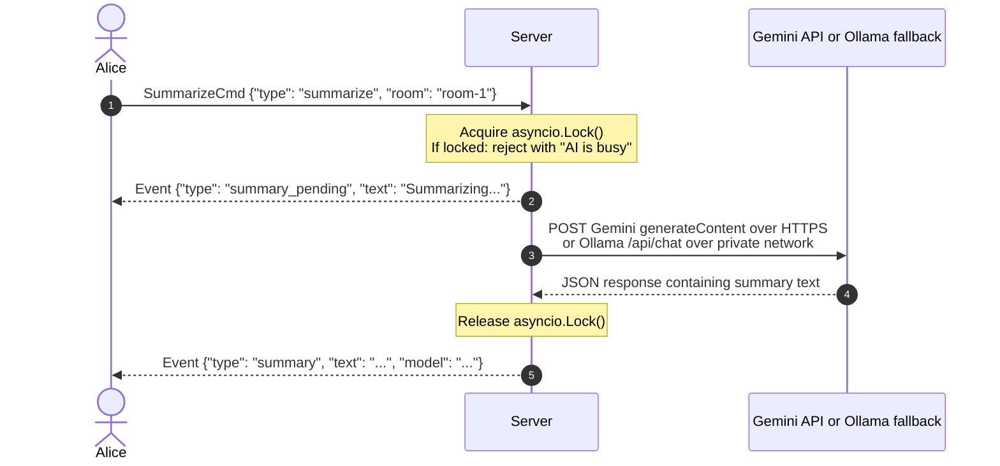

# Relay — System Architecture & Execution Lifecycle

This document provides a comprehensive end-to-end walkthrough of how **Relay** operates—from the initial browser connection and WebSocket handshake, through room routing and messaging lifecycles, to AI summarization and connection teardown.

---

## 1. Core Architecture Overview

Relay is built on a clean **Client-Server model** communicating exclusively over a **single persistent WebSocket endpoint (`/ws`)**:

```
[ Browser Client (HTML/CSS/JS) ]
         |
         |  Single Persistent WebSocket (/ws)
         |  Bidirectional JSON Frames
         v
[ Python Backend (aiohttp + Pydantic v2) ]
         |
         |  HTTPS with Gemini key; otherwise internal Docker HTTP (Port 11434)
         v
[ Gemini 3.5 Flash-Lite / Ollama Qwen2.5 fallback ]
```

* **Frontend (`static/app.js`):** Constructs strongly-typed commands via `ModelCmd` and dispatches them over the WebSocket. UI updates are event-driven and DOM updates are applied surgically (e.g. `appendMessage`, in-place receipt updates).
* **Backend (`server.py`):** Uses an asynchronous Dispatcher pattern (`server.dispatch`). Every incoming JSON frame is validated against dedicated **Pydantic v2 models** before invoking specialized handlers.
* **In-Memory State:** Connections live in `ChatServer.sessions: dict[str, UserSession]`, and chat rooms live in `ChatServer.rooms: dict[str, ChatRoom]`. Messages in each room are ring-buffered (`collections.deque(maxlen=100)`).

---

## 2. Command & Model Reference

Every action in the system has a 1-to-1 mapping between the frontend `ModelCmd` helper and the backend `Pydantic` schema:

| Action | Frontend Builder (`ModelCmd`) | Backend Schema (`Pydantic`) | Server Handler | Key Parameters |
|---|---|---|---|---|
| **Register** | `ModelCmd.register(name)` | `RegisterCmd` | `handle_register` | `name: str` (1–24 chars) |
| **Open Private Chat** | `ModelCmd.openPrivate(peer)` | `OpenPrivateCmd` | `handle_open_private` | `peer: str` (target session UUID) |
| **Create Group** | `ModelCmd.createGroup(name)` | `CreateGroupCmd` | `handle_create_group` | `name: str` (1–40 chars) |
| **Join Group** | `ModelCmd.joinGroup(room)` | `JoinGroupCmd` | `handle_join_group` | `room: str` (room UUID) |
| **Send Message** | `ModelCmd.message(room, text)` | `MessageCmd` | `handle_message` | `room: str`, `text: str` (1–4000 chars) |
| **Send File** | `ModelCmd.file(room, name, data)` | `FileCmd` | `handle_file` | `room: str`, `filename: str`, `data: str` (Base64 $\le 256$ KiB) |
| **Mark Delivered** | `ModelCmd.received(room, ids)` | `ReceiptCmd` | `handle_receipt` | `type: "received"`, `room: str`, `ids: list[str]` |
| **Mark Read** | `ModelCmd.read(room, ids)` | `ReceiptCmd` | `handle_receipt` | `type: "read"`, `room: str`, `ids: list[str]` |
| **AI Summary** | `ModelCmd.summarize(room)` | `SummarizeCmd` | `handle_summarize` | `room: str` (room UUID) |

---

## 3. End-to-End Execution Lifecycles

### Phase 1: Connection & Authentication (R2, R3, R4)



1. **HTTP Upgrade (`/ws`):** The browser loads the client files and initiates an HTTP GET request to `/ws` with headers `Upgrade: websocket` and `Connection: Upgrade`.
2. **Session Initialization:** `ws_handler` instantiates a `UserSession(socket=socket, id=uuid.uuid4().hex)`. The session is keyed by UUID, not username.
3. **Registration Dispatch:** Alice's client sends `RegisterCmd`:
   ```json
   { "type": "register", "name": "Alice" }
   ```
4. **Validation & De-duplication:**
   - Server evicts any closed sockets (`s.socket.closed`) to eliminate ghost collisions if Alice rapidly reloaded her browser.
   - Checks that no active session holds `"alice"` (case-insensitive via `.casefold()`).
   - If taken, sends `{"type": "error", "message": "That name is already connected. Choose another."}`.
5. **Presence Broadcast:** Server replies with `welcome` to Alice, then calls `broadcast_presence()`, sending updated user and group lists to all connected clients.

---

### Phase 2: Room Routing & Group Joining (R5, R8, R9, R10)

Relay isolates conversations into dedicated `ChatRoom` instances:

#### A. 1-on-1 Private Chat (R5, R7)
1. Alice clicks "Bob" in her "Online Users" sidebar list.
2. Client sends `OpenPrivateCmd`:
   ```json
   { "type": "open_private", "peer": "<bob_session_id>" }
   ```
3. Server looks up or generates a private room ID uniquely derived from the sorted participant IDs:
   `room_id = f"private:{min(alice_id, bob_id)}:{max(alice_id, bob_id)}"`.
4. Server delivers the room metadata and recent message history (`deque`) to Alice via event `{"type": "room", ...}`.

#### B. Group Creation & Self-Join (R8, R9, R10)
1. Alice types "Network Study" and submits the creation form $\to$ Client sends `CreateGroupCmd`.
2. Server creates a `ChatRoom(kind="group", members={alice_id})`. **Alice starts alone in the group** (R8).
3. Server calls `broadcast_presence()` $\to$ Bob immediately sees `# Network Study (1)` appear in his sidebar with a `Join` button (R9).
4. Bob clicks `Join` $\to$ Client sends `JoinGroupCmd`:
   ```json
   { "type": "join_group", "room": "<room_id>" }
   ```
5. Server adds Bob's session ID to `room.members` and broadcasts updated state to everyone. **Bob joins voluntarily without being forced** (R10).

---

### Phase 3: Text Messaging & The 3-Stage Receipt Lifecycle (R6, R7, R11, Special 3)

When a message is sent, it progresses through three distinct verifiable states:
**`✓ Sent`** $\longrightarrow$ **`✓✓ Delivered`** $\longrightarrow$ **`✓✓ Read`**.



#### Detailed Breakdown:

1. **Sending (Alice):**
   * Alice sends **only** `MessageCmd`:
     ```json
     { "type": "message", "room": "<room_id>", "text": "Hello!" }
     ```
   * Server verifies Alice is an authorized member (`authorized_room`). If it's a private chat, server verifies the peer is still online.
   * Server creates the message record:
     ```python
     message = {
         "id": uuid.uuid4().hex,
         "room": room.id,
         "sender": session.id,
         "name": session.name,
         "timestamp": time.time(),
         "kind": "message",
         "text": cmd.text,
         "read_by": [],
         "delivered_by": [],
     }
     ```
   * Broadcasts `{"type": "message", "message": message}` strictly to `room.members`.
   * **Alice's UI:** Since `delivered_by` and `read_by` are empty, Alice's UI renders **`✓ Sent`**.

2. **Delivery Receipt (Bob's Auto-Reply):**
   * As soon as Bob's WebSocket receives the message event:
     ```javascript
     if (state.me && data.message.sender !== state.me.id && !state.markedReceivedIds.has(data.message.id)) {
       state.markedReceivedIds.add(data.message.id);
       send(ModelCmd.received(room.id, [data.message.id]));
     }
     ```
   * Server appends Bob's ID to `message.delivered_by` and broadcasts `{"type": "receipt", ...}` back to room members.
   * **Alice's UI:** In-place DOM update changes the marker to **`✓✓ Delivered`**.

3. **Read Receipt (Bob's View Focus):**
   * When Bob's browser tab is active and visible (`!document.hidden && document.hasFocus()`), `markRead()` triggers:
     ```javascript
     const unread = room.messages
       .filter((m) => m.sender !== state.me?.id && !m.read_by.includes(state.me?.id) && !state.markedReadIds.has(m.id))
       .map((m) => m.id);
     if (unread.length) {
       for (const id of unread) state.markedReadIds.add(id);
       send(ModelCmd.read(room.id, unread));
     }
     ```
   * Server appends Bob's ID to `message.read_by` and broadcasts `{"type": "receipt", ...}`.
   * **Alice's UI:** In-place DOM update changes the marker to **`✓✓ Read`** (highlighted in blue).

---

### Phase 4: Base64 File Transfer via WebSocket (Special 2)

All file transfers take place strictly inside WebSocket frames without third-party object storage or external HTTP endpoints:

1. **Payload Packaging:** Alice selects a file $\le 256\text{ KiB}$. The browser client reads it as a Data URL (`FileReader.readAsDataURL`), strips the metadata header, and sends `FileCmd`:
   ```json
   {
     "type": "file",
     "room": "<room_id>",
     "filename": "report.pdf",
     "data": "JVBERi0xLjQKJ..."
   }
   ```
2. **Server Verification:** `FileCmd` validates `data` size. The server constructs a message of `kind: "file"` and broadcasts it to room members.
3. **Client Reception & Download:** Recipients reconstruct the binary blob locally via JavaScript:
   ```javascript
   const bin = atob(b64);
   const arr = new Uint8Array(bin.length);
   for (let i = 0; i < bin.length; i++) arr[i] = bin.charCodeAt(i);
   const url = URL.createObjectURL(new Blob([arr]));
   ```
   Renders a clickable link `[File: report.pdf (42.5 KiB)]` allowing instant client-side download.

---

### Phase 5: AI Chat Summarization (Special 1)



1. **Concurrency Control:** Server uses `self.ai_lock = asyncio.Lock()` to allow one summary request at a time.
2. **Provider:** The user chooses Gemini or local Qwen for each summary. A Gemini request sends recent chat text to Google over HTTPS; if Gemini fails or has no key, the server retries with Ollama via internal HTTP (`http://ollama:11434/api/chat`).
3. **Delivery:** The summary is sent to the requesting client via `{"type": "summary", ...}` and displayed in the chat panel.

---

### Phase 6: Disconnection & Cleanup (R1, Keepalive)

1. **Heartbeat Keepalive:** `aiohttp.web.WebSocketResponse(heartbeat=30.0)` automatically issues WebSocket `Ping` control frames every 30 seconds. If a client terminates without sending a TCP `FIN` (e.g. Wi-Fi drop or sudden sleep), the server detects socket failure within 30 seconds.
2. **Deterministic Cleanup (`disconnect`):**
   * When the socket reader loop exits, `finally: await server.disconnect(session)` executes.
   * Cancels any active AI summary tasks belonging to the session.
   * Removes `session.id` from `self.sessions`.
   * **Empty Group Eviction:** Discards the user from groups. If a group becomes empty (`not room.members`), the group is deleted automatically to prevent ghost rooms.
   * **Private Room Eviction:** If both participants in a private room disconnect, the private room is removed.
   * Calls `broadcast_presence()` to notify remaining clients to update their online users list immediately.
